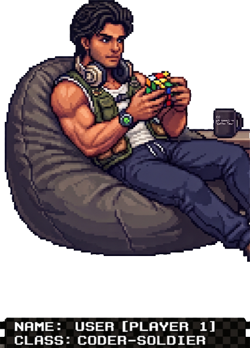
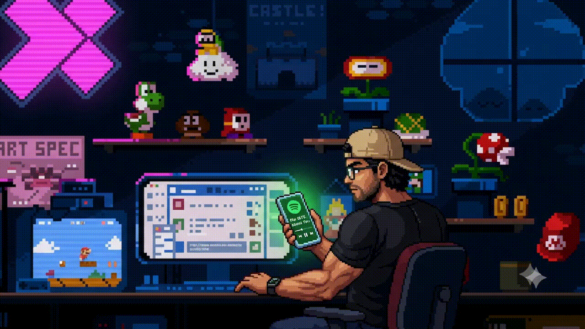
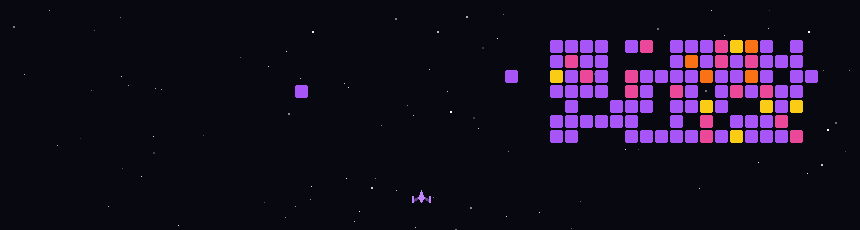

  

  
  &nbsp;&nbsp;&nbsp;
  
  &nbsp;&nbsp;&nbsp;
  

  

 

  

  

 

  

### `├─[ LANGUAGES ]────────────────────────────`

### `├─[ FRONTEND ]────────────────────────────`

### `├─[ BACKEND & FRAMEWORKS ]────────────────────────────`

### `├─[ DATABASES & RETRIEVAL ]────────────────────────────`

### `├─[ AI & DATA ]────────────────────────────`

### `├─[ DELIVERY & TESTING ]────────────────────────────`

**Additional cloud work:** AWS SDK / CDK contracts and infrastructure configurations; live AWS / Bedrock deployment has not been verified.

  

<!-- ====================================================== -->
<!-- FEATURED PROJECTS                                      -->
<!-- ====================================================== -->

 

<!-- ================= PROJECT 01 ================= -->

<a href="https://github.com/dgexplores/aegis-gateway">
  <picture><source media="(max-width: 700px)" srcset="./assets/projects/aegis-gateway-card-mobile.svg?v=content-review" /></picture>
</a>

<!-- ================= PROJECT 02 ================= -->

<a href="https://github.com/dgexplores/neuro-agent">
  <picture><source media="(max-width: 700px)" srcset="./assets/projects/neuro-agent-card-mobile.svg?v=content-review" /></picture>
</a>

<!-- ================= PROJECT 03 ================= -->

<a href="https://github.com/dgexplores/vigil">
  <picture><source media="(max-width: 700px)" srcset="./assets/projects/vigil-card-mobile.svg?v=content-review" /></picture>
</a>

<!-- ================= PROJECT 04 ================= -->

<a href="https://github.com/dgexplores/hustlrzz">
  <picture><source media="(max-width: 700px)" srcset="./assets/projects/hustlrzz-card-mobile.svg?v=content-review" /></picture>
</a>

<!-- ================= PROJECT 05 ================= -->

<a href="https://github.com/dgexplores/DRONA">
  <picture><source media="(max-width: 700px)" srcset="./assets/projects/dronav2-card-mobile.svg?v=content-review" /></picture>
</a>

<!-- ================= PROJECT 06 ================= -->

<a href="https://github.com/dgexplores/ai-support-agent">
  <picture><source media="(max-width: 700px)" srcset="./assets/projects/ai-support-agent-card-mobile.svg?v=content-review" /></picture>
</a>

<!-- ================= PROJECT 07 ================= -->

<a href="https://github.com/dgexplores/smart-chatbot">
  <picture><source media="(max-width: 700px)" srcset="./assets/projects/smart-chatbot-card-mobile.svg?v=content-review" /></picture>
</a>

<!-- ================= PROJECT 08 ================= -->

<a href="https://github.com/dgexplores/bank-customer-churn-scoring">
  <picture><source media="(max-width: 700px)" srcset="./assets/projects/bank-churn-card-mobile.svg?v=content-review" /></picture>
</a>

  

## Interview demonstrations

[Open the verified demo guide](https://interview-161-118-164-31.sslip.io/) for project links, checked journeys and limitations.

- **[NeuroAgent](https://neuro-161-118-164-31.sslip.io/):** hosted CI and Oracle release passed; 181 backend tests passed. A fresh fictional Gemini response, saved-case retrieval and owner isolation were verified. Extends an upstream project.
- **[Hustlrzz](https://hustlrzz.vercel.app/):** restored and checked through sign-in, resume indexing, role-fit analysis and a text interview with saved AI scoring. Team project; voice/camera behavior needs rehearsal.
- **[AEGIS](https://aegis-gateway-free.onrender.com/dashboard):** retrieval and safety demonstrations use the echo provider.
- **[Vigil](https://vigil-161-118-164-31.sslip.io/login):** fictional bank login and database safeguards verified. Extends upstream Vigil and Bank of Anthos.

Free hosting and model quotas can affect availability. The guide records the verification boundaries.

<!-- ====================================================== -->
<!-- CONTRIBUTION ACTIVITY                                  -->
<!-- ====================================================== -->

<picture>
  <source media="(prefers-reduced-motion: reduce)" srcset="./assets/space-shooter-static.png" />
  
</picture>

  

## 🤝 Let's Connect

---

**"Code. Learn. Build. Repeat."**
