# Deepak Gangwar

Python · GenAI applications · Backend engineering

I build AI applications with retrieval, structured model outputs, access controls, and testable backend workflows. My projects cover AI gateways, interview coaching, and durable agent workflows.

[Project demos and verification status](https://interview-161-118-164-31.sslip.io/) · [LinkedIn](https://www.linkedin.com/in/deepak-gangwar-1231033b5/) · [Email](mailto:gangwardeepak7878@gmail.com)

## Selected projects

| Project | Engineering focus | Explore |
| --- | --- | --- |
| [AEGIS](https://github.com/dgexplores/aegis-gateway) | Tenant-aware AI gateway: retrieval, privacy masking, provider routing, and HMAC-linked audit records. The public demo uses an echo provider to demonstrate controls. | [Controls demo](https://aegis-gateway-free.onrender.com/dashboard) |
| [NeuroAgent](https://github.com/dgexplores/neuro-agent) | Educational AI assessment workflow: structured Gemini responses, JWT-scoped case storage, and a bounded fictional example. Extends an upstream project. | [Fictional example](https://neuro-161-118-164-31.sslip.io/) |
| [Vigil](https://github.com/dgexplores/vigil) | Banking agent workflow: persistent outbox, retries and deduplication, investigation, and PostgreSQL account locks. Extends upstream Vigil and Bank of Anthos. | [Fictional bank](https://vigil-161-118-164-31.sslip.io/login) |
| [Hustlrzz](https://github.com/dgexplores/hustlrzz) | Team-built interview coach with text/voice practice, retrieval, provider failover, and browser-local presence analysis. | [Application](https://hustlrzz.vercel.app/) |
| [BloomPulse](https://github.com/dgexplores/hyperbloom-bloompulse) | Sensor anomaly analysis with Isolation Forest, physics checks, and cited maintenance guidance. Evaluation fixtures are synthetic. | [Keyless sample](https://hyperbloom-bloompulse.vercel.app/?demo=failing) |
| [DRONA](https://github.com/dgexplores/DRONA) | Django learning platform with staff/manager workflows, quizzes, progress tracking, and verifiable certificates. | [Application](https://dronav2.onrender.com/) |

**Current demo limits:** Hustlrzz's restored deployment has passed authenticated role-fit analysis, resume indexing, and a bounded text interview with saved AI scoring. NeuroAgent's public example works; hosted backend CI remains under investigation. Free hosting and model quotas can affect availability. The [demo guide](https://interview-161-118-164-31.sslip.io/) records the checked journeys and limitations.

## Technical focus

- **AI applications:** retrieval pipelines, source citations, structured outputs, provider integration, and evaluation boundaries.
- **Backend systems:** Python, FastAPI, Django, PostgreSQL, SQLite, authentication, and durable workflows.
- **Delivery:** Docker, GitHub Actions, deployment verification, regression tests, and reproducible demonstrations.

Each repository documents its setup, architecture, validation, contribution scope, and known limitations. Upstream adaptations and team work are identified in their project documentation.

## Contributions

<picture>
  <source media="(prefers-reduced-motion: reduce)" srcset="assets/space-shooter-static.png" />
  
</picture>

Built from my GitHub contributions · refreshed daily with GitHub Actions · powered by [gh-space-shooter](https://github.com/czl9707/gh-space-shooter).
